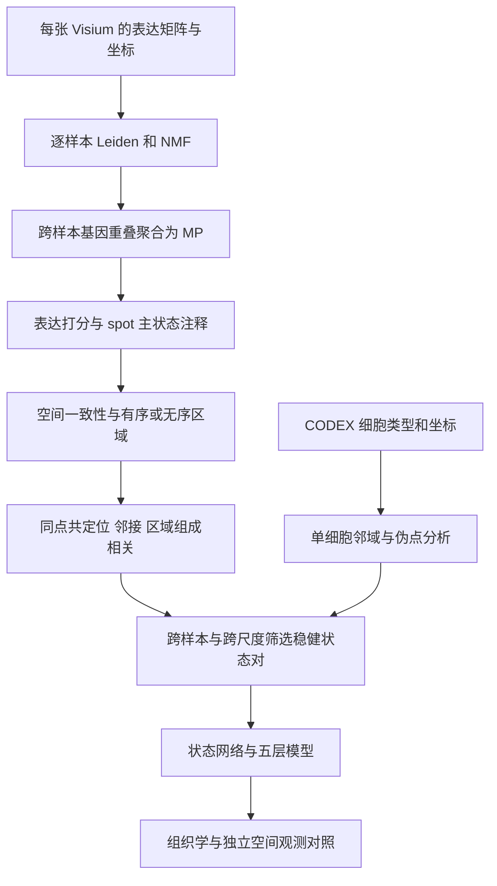

# P003｜胶质母细胞瘤的空间层次：从 MP 到多尺度关联网络

阅读日期：2026-11-19。Greenwald AC, Galili Darnell N, Hoefflin R, et al. *Integrative spatial analysis reveals a multi-layered organization of glioblastoma*. Cell 187, 2485–2501.e26 (2024). [DOI](https://doi.org/10.1016/j.cell.2024.03.029)｜[PMC 全文](https://pmc.ncbi.nlm.nih.gov/articles/PMC11088502/)｜[作者代码](https://github.com/tiroshlab/Spatial_Glioma/tree/f38f9b60ddbeefd9739e1483cbc66b2650f931d3)。

## 对 hypoxia 项目最重要的结论

**本文提供的是细胞状态注释后的空间组织分析框架，不是 scRNA→Xenium 的映射算法。** 它适合帮助回答“不同 MP 是否在缺氧相关区域形成可重复的邻域与层次”，不能替代解决 3CA 参考谱、5K 面板可识别性和跨平台映射的问题。

论文的 layer 是细胞状态关联网络与组织学共同支持的空间层次模型。作者先发现哪些状态在不同空间尺度上相伴，再组织成五层；没有先围绕缺氧区域按距离切成五个圆环，也没有提供可直接输入任意 Xenium 数据并输出五层的分类器。图中的环形示意不等于每块肿瘤都有完整、同心、等厚的五圈。

## 阅读和核查范围

已阅读 PMC 作者稿正文、相关 STAR Methods 和主图图注，查看 Fig.4、Fig.5、Fig.6 图像；静态核查作者仓库 README 及 Modules 1、2、3、4、6，固定提交为 `f38f9b60ddbeefd9739e1483cbc66b2650f931d3`。Cell 页面未成功读取，采用 PMC 全文；补充材料没有完整逐项核对，Module 5 CNA 实现不在本次审查范围。作者提供了 Inputs.zip，本次未获取其中输入、预计算对象和配准说明，也未运行作者分析。

下文 `[P:Lx]` 指本地固定全文提取的行号，`[M1:Lx]` 等指固定提交对应模块行号；原文段落标题和 GitHub 定位同时提供，详见[来源与哈希说明](../../reconstructions/greenwald-2024-layers/PROVENANCE.md)。图注在提取文本中存在重复，不作为独立证据计数。

## 研究对象与证据边界

作者新测了 19 张 glioma Visium 切片：13 张 IDH-WT GBM、6 张 IDH-mutant glioma，另纳入外部 13 张 GBM 切片；CODEX 对应 12 张近邻 GBM 切片，使用 40 抗体面板。部分同一肿瘤有多个组织块，**切片数不等于独立患者数**。Visium 点直径 55 μm，中心距 100 μm；一个点通常混合多个细胞。[P:L49–L52]

本文的主要推断对象是人脑肿瘤中的状态组织；用户数据则是小鼠 PDAC、单细胞分割的 Xenium 5K。物种、器官、基因覆盖、观测单位和空间网格都发生改变。

## layer 分析流程逐步拆解

### 1. 先发现并注释 MP，尚未分析 layer

Methods 对每样本做 NMF，K=2–11，每个程序取权重最高的 50 基因；筛选同样本跨 K 稳健、跨样本重复的程序，再与 Leiden 程序合并，通过基因重叠聚类形成 MP。GBM 最终有 14 个 MP，包含肿瘤状态和非恶性细胞类型，部分簇还经过人工拆分或排除。[P:L144–L150；Fig.2]

代码中的 NMF 调用是 `NMF::nmf(..., nrun=5, method="snmf/r")`；跨样本 MP 生成沿用 Kinker/Gavish/3CA 思路。**这与用户逐样本 NMF→跨样本 MP 的概念路线接近，但不是同一实现，也不是 starCAT 固定参考投射。** 论文还合并了 Leiden 程序，用户则按细胞大类独立发现 MP。[M1:L260–L266、L332–L355]

之后使用 `scalop::sigScores`：基因集平均中心化表达减去表达匹配对照分数，主状态取最高分。它不是将 scRNA NMF 完整谱传入 starCAT。用于同点共定位的另一份表示把 MP score >0.1 视为出现，允许同点有多个 MP；最高分硬标签与多 MP 出现矩阵不能混用。[P:L163–L170、L182；M1:L618–L648]

### 2. 衡量状态是否聚集，划分 structured / disorganized

一个 MP 的 spatial coherence 是其 spot 周围同 MP 直接邻点数量的平均值，再以随机打乱和理想六边形聚集作尺度归一：

`coherence = (observed − shuffled baseline) / (ideal maximum − shuffled baseline)`

全样本指标用 100 次打乱估计基线。局部区域使用半径为 5、8、11 个六边形网格圈的窗口；三个尺度都高于所有样本 spot 的第 40 百分位，才归 structured；都低于则归 disorganized；其余为 intermediate，再用 r=4 窗口多数类别平滑。论文还用 CNA 恶性程度区分 malignant / normal 区域。[P:L174–L180；Fig.4A–E]

这里的“有序”表示同类状态的空间组织程度，**还不是某个 layer**。代码局部计算包含 MP spot 最少数量、丰度较高时改变归一公式、区域平滑后冲突处理等细节，不能只复制 Methods 的一句话。[M2:L219–L290、L300–L486]

### 3. 用三个互补视角计算状态对关系

| 分析 | 输入与含义 | Methods 主要设置 | 输出不能解释成什么 |
| --- | --- | --- | --- |
| 同点共定位 | MP 出现的二值矩阵；两程序是否出现在同一混合 spot | score >0.1；500 次打乱；显著筛选含效应量与 p 值 | 不能直接证明同一细胞共表达，更不能证明细胞间作用 |
| 直接邻接 | spot 主状态及六边形直接邻居；A 附近 B 是否富集 | 校正 B 可用于异类相邻的边界容量；10,000 次打乱 | 不是配体受体通信检验；不能把有向值随意当无向值 |
| 区域组成相关 | 每个滑动窗口中各 MP 的相对丰度；A/B 丰度跨窗口是否相关 | 半径 r=1–15；排除单一状态窗口；500 次打乱 | 重叠窗口不是独立样本；组成相关不等于接触 |

Fig.5 将同点、邻接及区域 r=5、8、15 汇总为五种尺度/测量视角。同一状态对可随尺度由相伴转为排斥。因此只报告一个邻域半径会遗漏尺度依赖关系。[P:L85–L92、L182–L190]

**统计实现有实质差异，见下方代码审计，不能直接把 Methods 的效应量方向或检验名称当作代码行为。**

### 4. 跨样本共识关系与 layer 网络不是完全相同的筛选

Methods 先对每种测量缩放；某状态对跨样本平均 scaled score >0.35，且至少 20% 样本达到显著，称 strongly connected。共识关系要求至少五种测量中的两种支持，并且至少一种是直接耦合（同点或邻接），论文报告 structured 中 21 对，disorganized 中 2 对。[P:L190]

**构建 Fig.6 layer 网络时放宽了“必须含直接耦合”的限制**，允许任意两种测量支持，因此比 21 对再增加 4 对；网络使用 Cytoscape 3.9.1。不能把 Fig.5 共识关系筛选与 Fig.6 网络输入当成同一个集合。[P:L192]

固定提交的 Module 4 还添加了跨测量总体均值的筛选；本次没有找到生成上述扩展网络及最终 layer 分配的完整活动代码链。Module 6 的 `levels_layers` 是画图排序向量，不是自动学习 layer 的算法。[M4:L91–L100、L194–L200；M6:L795 起]

### 5. 五层的实际含义与验证

| 论文层次 | 主要状态/细胞 | 解释与限制 |
| --- | --- | --- |
| L1 | MES-Hyp | 与缺氧/坏死相关的中心状态；表达状态不是氧浓度测量 |
| L2 | MES-Ast、MES、Inflammatory-Mac | 位于缺氧相关状态与外侧状态之间；无直接对应的经典组织学层 |
| L3 | Vasc、Mac、Prolif-Metab；CODEX 补充 T/B 细胞 | 血管、免疫与部分肿瘤状态的关联层；不意味着所有 T 细胞必在此层 |
| L4 | AC、OPC、NPC | 脑肿瘤特有的神经发育样恶性状态 |
| L5 | Reactive-Ast、Oligo、Neuron | 正常脑相关外部环境；PDAC 不存在可照搬的等价细胞组合 |

Fig.6A 展示状态关联网络，Fig.6B 展示组织图像与概念示意，其他面板结合 IVY GAP 的组织学区域。Chromatin-Reg 因跨测量与跨模态不一致，未被强制分层。**允许状态不归层、局部无层次，是模型本身的重要边界。** [P:L94–L98、L192；已查看 Fig.6]

作者用 MES-Hyp 状态表征缺氧相关区域，并将缺氧提出为长程组织因素。但低氧培养的类器官没有复现 MES-Hyp 状态及组织结构；作者明确说明缺乏合适模型验证其因果作用。因而这里支持缺氧相关空间组织，不能据此宣称“缺氧已被证明造成五层结构”。[P:L80–L81、L111]

## Methods 与活动代码核对

| 核对点 | Methods / 论文 | 固定代码 | 本次判断 |
| --- | --- | --- | --- |
| 同样本 NMF 稳健重叠 | 50 基因中至少 30 个重叠 [P:L148] | 函数默认 30，但活动调用 `intra_min=35`；随后又读入预计算 RDS [M1:L275、L337、L354–L355] | 材料冲突；不能由该调用断言论文最终对象一定用了 35 |
| 共定位效应方向 | expected/observed，显著效应 ≥1.3 [P:L182] | `r1`=observed，`r2`=expected，`effect_size <- r1/r2` [M3:L101–L113] | 方向相反，会影响富集/耗竭解释；保留双方，不擅自订正原文 |
| 共定位统计检验 | Fisher’s exact test [P:L182] | `atanh` 形式变换后用正态分布计算 p，没有该处的 `fisher.test` [M3:L107–L112] | 是 Fisher z 形式计算，并非 Fisher 精确检验；其适用于该共定位指标的假设仍需审查 |
| 区域相关统计检验 | Fisher’s exact test [P:L188] | 同样使用 Fisher z 形式，汇总含 `p<1e-10` 筛选 [M3:L422–L435] | 检验名称/实现不一致；不能把像素级显著当独立鼠级证据 |
| 共识网络门槛 | 每种测量平均分 >0.35，≥20% 样本显著，再按支持测量数筛选 [P:L190] | 先计算跨测量 `pair_mean`，只有总体均值 >0.35 的 `pattern="connected"` 才继续入选 [M4:L91–L100、L194–L200] | 活动实现增加一层筛选；缺历史运行对象，不能断言最终论文网络由此唯一生成 |
| CODEX 邻域归一 | A 的 B 邻居总数除以 A 细胞数 [P:L217] | 按 from type 汇总后除以该类型所有非自身类型的邻接计数 [M6:L415–L433] | 每个 A 的平均 B 数与异类边中 B 的比例是不同统计量 |
| CODEX 半径与迭代 | 半径 27.5/127.5 μm，500 次 [P:L217] | 所见活动调用为 27.5 μm、500 次；函数默认 10 次被调用覆盖 [M6:L785–L789] | 不能把默认 10 次误记为实际调用，也未确认该快照中 127.5 μm 的完整运行链 |
| 最终网络与图层分配 | 放宽到任意两种测量，Cytoscape 构图 [P:L192] | 已检查模块没有完整的最终扩展网络→layer 分配链 | 复现缺口，不等于作者从未提供其他材料；Inputs.zip 仍待核查 |

作者 README 明确称其为研究过程工作代码，并提示版本可影响 Modules 1–3 结果。文件依赖 `MP/`、`Summary_tables/` 等中间对象，部分路径需人工配置；因此当前材料适合静态审计，尚不构成完整的一键复现包。

## 对用户 3CA 与 Xenium 映射的直接回答

1. **不需要为了借鉴 layer 分析，把已有 3CA MP 全部换成本文或 starCAT 的 NMF。** layer 的核心输入是可靠的细胞状态、坐标和样本信息，MP 发现方法可以不同，但映射准确性必须先验证。
2. **本文不能解决“面板少基因导致打分不可靠”。** 它的 Visium 端仍使用基因集打分；CODEX 端依赖独立蛋白注释。不能以此为据直接把同一打分策略搬到 5K 面板。
3. **STalign 是空间图像配准。** 本文把近邻切片的 CODEX 细胞密度图对齐到 Visium H&E，再建伪点比较；没有空间坐标的解离 scRNA 不能靠 STalign 获得原位位置。[P:L209–L213]
4. 对 Xenium 最有价值的是 CODEX 风格的真实细胞邻域分析，以及多尺度、跨小鼠的稳定性评估。详细改造设计见[PDAC–Xenium 适用性与分析接口](../../docs/layer-analysis-for-pdac-xenium.md)。

## 本次交付状态

完成文献阅读、主图核查、固定代码静态对齐和项目适用性审查。没有运行 NMF、空间网络、starCAT 或用户数据分析。正式证据包将未解决差异标为“材料冲突”，缺输入的分析标为“受阻”；[结构校验](../../reconstructions/greenwald-2024-layers/validation_report.json)不等于生物学复现。
